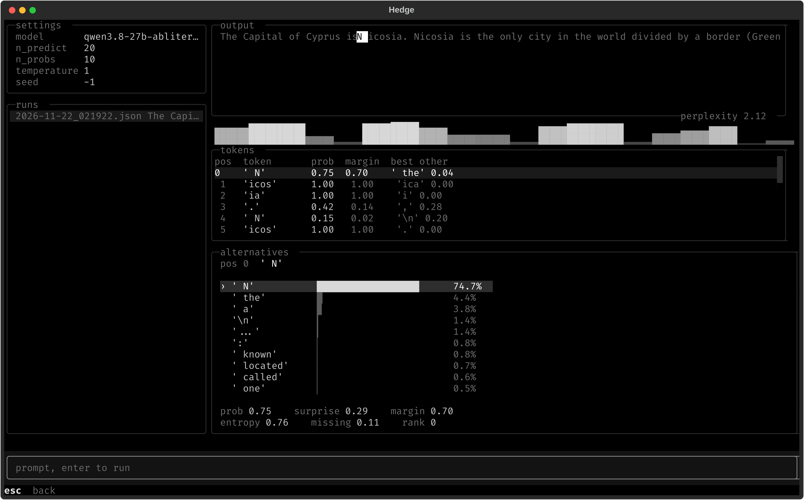

# Hedge

A terminal UI that shows how confident a local LLM was about every token it generated, as well as showing the alternative tokens



## Why

A finished answer reads the same whether the model was sure or guessing. Hedge shows where it hedged, and what it almost said instead

## Requirements

- python 3 with `numpy`, `requests`, `rich`, `textual`
- a [llama.cpp](https://github.com/ggml-org/llama.cpp) `llama-server` running on `127.0.0.1:8080`

## Install

with nix:

```sh
nix develop   # or: direnv allow
```

without:

```sh
pip install numpy requests rich textual
```

## Usage

```sh
python main.py
python main.py runs/some_run.json
```

type a prompt, hit enter. tweak `n_predict`, `n_probs`, `temperature`, `seed` in the settings panel

## Keys

| key     | action                    |
| ------- | ------------------------- |
| `enter` | run prompt / edit setting |
| `r`     | run                       |
| `h` `l` | previous / next token     |
| `j` `k` | move through alternatives |
| `p`     | focus prompt              |
| `e`     | focus settings            |
| `esc`   | back                      |
| `s`     | save run to `runs/`       |
| `q`     | quit                      |

## Metrics

- **prob**: probability of the chosen token
- **surprise**: `-ln(prob)`
- **margin**: gap between the top two candidates
- **entropy**: spread over the top-N candidates
- **missing**: probability mass outside the top-N
- **rank**: where the chosen token sits in the top-N
- **perplexity**: `exp(mean surprise)` over the whole run

## How it works

Hedge sends the prompt to llama-server's `/completion` with `n_probs` set, gets back the logprobs for each token and its top-N alternatives, then computes the metrics locally. Probabilities are pre-sampling, so temperature changes what gets picked but not the numbers shown. Runs are plain JSON, saved to `runs/`

## Limitations

- llama.cpp only, server address is hardcoded in `capture.py`
- only sees the top-N alternatives, so entropy is an approximation
- no streaming, the UI waits for the whole completion
- unsaved runs are gone when you quit

## License

MIT, see [LICENSE](LICENSE)
